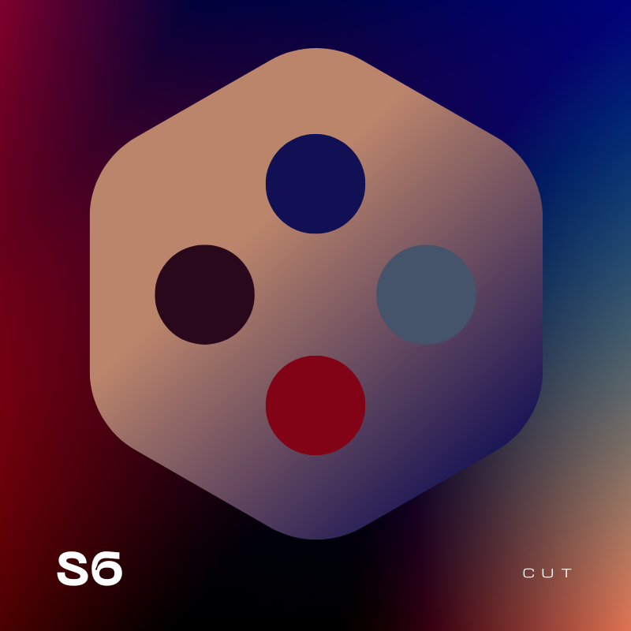

<a id="readme-top"></a>

<div align="center">
  

  <h1>S6_cut</h1>

  <p><b>Turn one long video into a folder of ready-to-post shorts—locally, without accounts, credits, watermarks, or artificial limits.</b></p>

  <p>
    
    
    
    
    
    
  </p>

  <p>
    <a href="#quick-start-docker">Quick start</a> ·
    <a href="#configuration">Configuration</a> ·
    <a href="#local-first-and-optional-api-behaviour">Local-first</a> ·
    <a href="#roadmap">Roadmap</a> ·
    <a href="https://github.com/carmelo-schepis/S6_CUT/issues">Report a bug</a>
  </p>
</div>

### Three steps

1. **Drop** a YouTube link or video file.
2. **Pick a style:** Funny, Serious, Educational, or Hype — or write your own instructions.
3. **Download** every finished clip, one by one or all at once. A ZIP-all download is in development.

S6_cut transcribes speech, finds clean sentence boundaries, creates vertical clips, and burns in word-by-word subtitles. Its context-aware visual system is designed to match spoken phrases with relevant images, GIFs, memes, posters, and assets from your own library — a feature currently in development.

---

> **Project status:** S6_cut is a self-hosted project under active development. The core pipeline — transcribe, find moments, reframe, edit, download — works today. Several features described in this README are part of the product vision and are being built. Each section states whether the feature is available now or in development. See the [Roadmap](#roadmap) for the full picture.

---

## Available now

The following features work in the current codebase. You can run them today with Docker Compose.

- **YouTube, Twitch and Kick downloads** — paste a URL or upload a local video file. yt-dlp with Deno-based bot detection handles YouTube; Kick and Twitch have dedicated clients.
- **Transcription** — Deepgram Nova-3 (default), ElevenLabs Scribe, or local Faster-Whisper. If a cloud provider is unavailable, S6_cut falls back to local Whisper automatically.
- **Viral moment detection** — Google Gemini scores every segment on hook strength, emotional payoff, quotability, self-containedness, and density. No Gemini key? Falls back to lexical TextTiling topic segmentation, then to one whole-video clip as a last resort.
- **Clean clip edges** — clips are snapped to word boundaries, then sentence boundaries, then waveform silence troughs. No clip opens or closes mid-word.
- **Vertical reframe** — active-speaker tracking with YOLOv8 person detection and MediaPipe face analysis. Three modes: Auto (face tracking), Subject (interest-weighted centroid crop), and Off (letterbox). Comfort mode locks the camera per scene so it doesn't feel seasick.
- **Per-clip editing** — colour grade presets, smart cut (filler-word and silence removal), hook text overlay, word-by-word karaoke subtitles (6 presets), brand logo watermark, and attribution banner. All settings are previewed before applying.
- **Publishing** — upload and schedule to TikTok, Instagram, and YouTube via Zernio (optional). SmartScheduler picks Italian-prime-time slots and avoids same-day collisions.
- **Live Monitor** — watch Twitch, Kick, or YouTube channels and auto-clip segments as they go live or upload. Multiple monitors run in parallel.
- **CPU-only Docker image** — no NVIDIA GPU required. The standard build is explicitly CPU-only. An optional GPU profile exists for those who want it.
- **No accounts, no credits, no watermark** — S6_cut adds no product watermark, requires no S6_cut account, and imposes no artificial limits. External API providers may have their own quotas and charges.

---

## Product vision / In development

These features are part of the S6_cut product direction. Some are partially implemented; others are planned. Each is labelled clearly.

### Long video to shorts

*Available now — described above.*

### Script to video

*Planned — not yet implemented.*

Upload or paste a script. S6_cut will analyse it, divide it into visual narration beats, and generate a finished video with subtitles. Every 2–3 seconds — or at a natural phrase boundary — a relevant image, GIF, poster, or library asset can appear on screen. ElevenLabs narration is optional. If ElevenLabs is missing or fails, the job continues without it.

This workflow produces a new video rather than clipping from an existing source.

### Context-aware images and GIFs

*In development — core architecture exists for text overlays; timed image/GIF selection is planned.*

S6_cut is designed to use timed subtitle and transcript context to select relevant visuals. If the speaker mentions the Beatles, for example, the app can select Beatles-related imagery and place it over the video at the relevant moment. You would not need to manually search for every visual.

How it is intended to work:

- Local library assets are searched first (see Asset Library below).
- Optional web images and GIFs may be used when enabled.
- Visuals are timed to words or semantic phrases.
- You can review, replace, block, or remove automatic selections.
- Externally sourced assets may carry licensing or attribution requirements — S6_cut will not imply that every web image is automatically free to reuse.

### Asset Library

*Planned — not yet implemented.*

A local library where you add images, GIFs, posters, logos, advertisements, products, and other reusable assets. Each asset is labelled with tags describing what it represents. Assets can be marked Automatic, Preferred, Required, or Blocked.

During video generation, S6_cut searches the library for labels relevant to the current sentence or narration beat. Ads and posters can be deliberately inserted through rules rather than selected randomly. Local library assets are preferred before any optional web search.

---

## Local-first and optional API behaviour

S6_cut is designed to run on your own hardware. Most processing happens locally. Some features become available when you optionally provide API keys.

| Configuration | Expected behaviour |
|---|---|
| No API keys | Local transcription (Whisper), local TextTiling clip finding, local reframe, local subtitles, all editing. A Gemini key is normally needed for AI-ranked clip selection; without it, the engine falls back to lexical topic segmentation. |
| Gemini key only | AI-ranked viral moment detection, AI-assisted trim instructions, AI edit suggestions. |
| Deepgram key | Cloud transcription (Nova-3) with multilingual code-switching. Falls back to local Whisper on failure. |
| ElevenLabs key | Alternative cloud transcription with audio-event tags (laughter, applause). Optional Voice Isolator for noisy sources. Falls back to local Whisper on failure. |
| Zernio credentials | Publish and schedule to TikTok, Instagram, and YouTube. |

**Key principles:**

- **Free and open source.** No S6_cut account, no credits system, no product watermark, no artificial limits.
- **Local-first.** Media processing and storage run on your own computer or server. No dedicated NVIDIA GPU is required for the standard installation.
- **No vendor lock-in.** Every optional API key has a documented local fallback. A missing key results in a skipped enhancement, never a fatal job error.
- **External APIs.** When you enable a provider, text or audio may be processed on their servers. S6_cut is not responsible for how those providers handle your data.

---

## Quick start (Docker)

```bash
git clone https://github.com/carmelo-schepis/S6_CUT.git
cd S6_CUT
docker compose up --build
```

- Backend: http://localhost:8000
- Frontend: http://localhost:5175

**No GPU required.** The standard image is CPU-only. Open the dashboard, drop in a YouTube URL or upload a file, and watch the pipeline run live.

> **First run after a pull** that touches `requirements.txt` or `package.json`: `docker compose down -v && docker compose up --build` to clear the stale anonymous volume on `/app/node_modules`.

### Optional NVIDIA GPU profile

```bash
docker compose -f docker-compose.yml -f docker-compose.gpu.yml up --build
```

### Production frontend (optional)

```bash
docker compose -f docker-compose.yml -f docker-compose.prod.yml up --build
```

Swaps the dashboard from the Vite dev server to a static build served by nginx. Same port 5175, same loopback default. Requires Docker Compose ≥ 2.24.

---

## TrueNAS and Portainer

S6_cut is designed for self-hosting on TrueNAS Scale and Portainer.

### Portainer stack

1. Create a new stack.
2. Paste the contents of `docker-compose.yml`.
3. Add `docker-compose.prod.yml` as an additional Compose file for the production frontend.
4. Set the `S6CUT_BIND` environment variable to `0.0.0.0` if you want LAN access, and pair it with `S6CUT_API_TOKEN` for authentication.

### TrueNAS custom app

1. Use the "Custom App" or "Launch Docker Image" option.
2. Set the image to your locally built `s6-cut-backend` image.
3. Map host paths to these persistent volumes:

| Host path | Container mount | Purpose |
|---|---|---|
| `/mnt/pool/s6-cut/data` | `/app/data` | Configuration, cookies, transcript cache |
| `/mnt/pool/s6-cut/output` | `/app/output` | Finished clips and projects |
| `/mnt/pool/s6-cut/uploads` | `/app/uploads` | Uploaded source videos |
| `/mnt/pool/s6-cut/library` | `/app/library` | Asset Library (when implemented) |

4. Port map `8000` for the backend API.
5. Add the frontend as a separate container using the `s6-cut-frontend` image, port `5175`.

Persistent storage documentation is in development. For now, review the Docker volumes in `docker-compose.yml`.

---

## Local development (no Docker)

```bash
# Backend
pip install -r requirements.txt
pip install -e .                                       # registers the s6_cut package
python -m uvicorn s6_cut.api.app:app --reload --port 8000

# Frontend (separate terminal)
cd dashboard && npm install && npm run dev

# Pipeline CLI (one-shot, no API)
python -m s6_cut.pipeline.main <url_or_path> [--instructions "focus on hooks"] \
                                                [--reframe-mode auto|subject|disabled] \
                                                [--no-zoom]
```

---

## Configuration

API keys, model selection, and cookies are managed from the dashboard Settings tab and persisted to `data/config.json` (mode `0600`, git-ignored). No `.env` file is required for basic operation.

<details>
<summary><b>Runtime environment variables (click to expand)</b></summary>

| Variable | Default | Purpose |
|---|---|---|
| `S6CUT_BIND` | `127.0.0.1` | Host interface both published ports bind to. `0.0.0.0` exposes the app to the LAN. |
| `S6CUT_API_TOKEN` | _(unset)_ | Optional shared-secret auth for `/api` requests. |
| `TRANSCRIPTION_PROVIDER` | `deepgram` | `deepgram`, `elevenlabs`, or `whisper` to force local. |
| `S6CUT_TRANSCRIBE_AUDIO_ONLY` | `true` | Strip to audio-only FLAC before transcription. |
| `S6CUT_SILENCE_SNAP` | `1` | Refine clip edges to the nearest waveform silence trough. |
| `S6CUT_X264_CRF` | `18` | libx264 quality for all render passes (0–51). |
| `S6CUT_X264_PRESET` | `medium` | libx264 speed preset. |
| `S6CUT_JOB_MAX_ATTEMPTS` | `3` | Worker attempts per queued job. |
| `S6CUT_RENDER_QA_RETRIES` | `1` | Extra render attempts after a critical QA failure. |
| `S6CUT_KEEP_CHECKPOINTS` | `0` | Keep hidden transcript checkpoints after a successful job. |
| `S6CUT_MAX_DURATION_SECONDS` | _(disabled)_ | Preflight quota: reject sources longer than this. |
| `S6CUT_MAX_INPUT_GB` | _(disabled)_ | Preflight quota: reject inputs larger than this. |
| `S6CUT_MAX_ESTIMATED_COST_USD` | _(disabled)_ | Reject a job whose estimated Gemini spend exceeds this. |
| `S6CUT_MIN_FREE_DISK_GB` | `1` | Free space that must remain after estimated peak disk use. |
| `S6CUT_MAX_CLIPS` | _(disabled)_ | Cap how many ranked candidates are rendered. |
| `S6CUT_CREATOR_NAME` | _(unset)_ | Channel owner name passed to the Gemini prompt. |
| `S6CUT_MIN_VIRAL_SCORE` | _(disabled)_ | Drop clips scoring below this (1–100). |
| `S6CUT_QA_SIGNAL` | `1` | `0` runs structural output QA only. |
| `REFRAME_COMFORT` | `1` | Anti-nausea camera lock. `0` = original single-pass tracker. |
| `REFRAME_STATIC_AUTO` | on | Lock the camera per scene. `0` = eased-but-moving smoother. |
| `REFRAME_MOTION_WIDE_THRESH` | `0.12` | Subject movement threshold before TRACK→WIDE demotion. |
| `REFRAME_SMOOTHER` | _(blank)_ | `euro` or `spring` for alternative camera smoothers. |
| `REFRAME_LOST_HOLD` | `90` | Frames to hold a lost subject before drifting to centre. |
| `REFRAME_LOST_DRIFT` | `0.05` | Per-frame ease rate of drift-to-centre recovery. |
| `REFRAME_SALIENT_GENERAL` | _(off)_ | Content-aware crop for faceless scenes. |
| `REFRAME_OBJECT_WEIGHTS` | _(off)_ | Weighted-object centroid for faceless scenes. |
| `REFRAME_FRAMESHIFT_WEIGHTS` | _(GUI defaults)_ | `object`-mode class weights. |
| `REFRAME_GLOBAL_SMOOTH` | _(off)_ | Opt-in 2-pass trajectory smoothing. |
| `REFRAME_GLOBAL_METHOD` | `savgol` | `savgol`, `kalman`, or `l2` (requires `STATIC_AUTO=0`). |
| `REFRAME_SPEAKER_SWITCH_MARGIN` | `1.25` | Identity switch hysteresis. |
| `REFRAME_MIN_FACE_RATIO` | `0.10` | Ignore faces smaller than this share of the largest candidate. |
| `REFRAME_DIALOGUE_GROUP` | `1` | Keep two active participants in frame. |
| `REFRAME_DIALOGUE_SCORE_RATIO` / `REFRAME_DIALOGUE_SEPARATION` | `0.88` / `0.28` | Group-framing thresholds. |
| `YTDLP_PLAYER_CLIENTS` | `default,tv+tv_embedded,web_safari` | yt-dlp player-client fallback chain. |
| `MAX_FILE_SIZE_MB` | `16384` | Max local-video upload size in MB. |
| `ZERNIO_DEFAULT_TZ` | `Europe/Rome` | SmartScheduler timezone. |
| `ZERNIO_MIN_GAP_SECONDS` | `5400` | Minimum gap between scheduled posts. |
| `TWITCH_CLIENT_ID` / `TWITCH_CLIENT_SECRET` | _(unset)_ | Helix app credentials for Twitch monitor. |

</details>

---

## Runtime resilience and output QA

<details>
<summary><b>Click to expand</b></summary>

Queued jobs run through `s6_cut.pipeline.orchestrator`, which wraps the pipeline stages with durability and verification.

- **Durable lifecycle** — each job directory keeps `.s6_cut_runtime.json` (phase, progress, attempt state) and `.s6_cut_checkpoint/` (reusable transcript and phase artefacts). Writes are atomic and fsync'd. A restart reuses completed work instead of starting over.
- **Bounded retries** — transient failures back off exponentially up to `S6CUT_JOB_MAX_ATTEMPTS`. Exit code `2` (validation or preflight rejection) is never retried.
- **Preflight** — before expensive work, the source is probed and runtime, disk, and Gemini cost are estimated. A job that would blow a quota is rejected up front.
- **Output QA** — every temporary render is checked for size, duration, stream presence, aspect ratio, black/frozen-frame ratio, and audio levels. Structural defects trigger a bounded re-render; signal findings stay as warnings.
- **Regression suites** — `python -m s6_cut.pipeline.quality_suite <manifest>.json --output report.json` replays the production QA policy over versioned fixture clips.

</details>

---

## Architecture and technology stack

<details>
<summary><b>Click to expand</b></summary>

| Layer | Technology |
|---|---|
| Backend | Python 3.11, FastAPI, Pydantic v2, asyncio queue |
| Pipeline | yt-dlp, Deepgram REST, ElevenLabs Scribe REST, Faster-Whisper, PySceneDetect, YOLOv8 (Ultralytics), MediaPipe, ffmpeg, auto-editor (Nim binary), Pillow |
| AI | Google Gemini (viral detection), Deepgram Nova-3 / ElevenLabs Scribe (transcription) |
| Frontend | React 18, Vite 6, Tailwind CSS v4, lucide-react |
| Publishing | Zernio multi-platform API (optional) |
| Deployment | Docker Compose (CPU multi-arch + optional NVIDIA GPU profile) |

The backend uses an `src/`-layout Python package. The frontend is a separate Vite app. Tests live at the repository root.

</details>

---

## Security and privacy

<details>
<summary><b>Click to expand</b></summary>

- Published ports bind to `127.0.0.1` by default. LAN exposure is opt-in via `S6CUT_BIND=0.0.0.0`.
- An optional API token (`S6CUT_API_TOKEN`) authenticates every `/api` request when set.
- UUID4 validation on every `{job_id}` path parameter.
- Trusted-origin guard on config-mutation endpoints.
- Pydantic patterns on all subtitle and hook fields prevent FFmpeg filtergraph injection.
- Uploaded media files are saved with server-generated names; the client-supplied filename is discarded.
- `data/config.json` and `data/cookies.txt` are written with mode `0600`.
- Internal exceptions never leak stack traces to API clients.
- SSRF hardening: download and Zernio upload URLs are re-resolved and rejected when every resolved address is internal or link-local.
- A pre-commit hook blocks committing API keys, tokens, cookie files, and `.env`. Enable with `git config core.hooksPath .githooks`.

**Not yet in place:** a reverse proxy with TLS termination and security headers. Required before exposing the application to the public internet.

</details>

---

## Development and testing

<details>
<summary><b>Click to expand</b></summary>

```bash
# Backend host tests (fast, no CV stack) + lint
pip install -e ".[host-tests]" && pip install pytest ruff
pytest -m "not integration" -q
python -m ruff check src/s6_cut tests --select E9,F63,F7,F82

# Heavy integration tests (Docker only)
docker compose run --rm -u root backend sh -lc "pip install -q pytest && pytest -m integration"

# Frontend
cd dashboard && npm ci && npm test && npm run lint && npm run build
```

</details>

---

## Roadmap

- [x] **YouTube, Twitch, Kick download** — working with yt-dlp, bot-detection bypass, and cookie support.
- [x] **Transcription** — Deepgram, ElevenLabs, and local Whisper with automatic fallback.
- [x] **Viral moment detection** — Gemini ranking with TextTiling fallback.
- [x] **Smart clip edges** — word, sentence, and silence snapping.
- [x] **Vertical reframe** — Auto, Subject, and Off modes with comfort-mode camera lock.
- [x] **Per-clip editing** — colour grade, smart cut, hook text, karaoke subtitles, brand logo, attribution banner.
- [x] **Publishing** — Zernio integration for TikTok, Instagram, YouTube.
- [x] **Live Monitor** — Twitch, Kick, YouTube auto-clip and publish.
- [x] **CPU-only Docker image** — no GPU required.
- [ ] **Style selector** — Funny, Serious, Educational, Hype presets map to AI instructions.
- [ ] **ZIP-all download** — download every completed clip as a single ZIP file.
- [ ] **Script to video** — paste a script, generate a finished video with subtitles and optional narration.
- [ ] **Context-aware timed images and GIFs** — match spoken phrases with relevant visuals.
- [ ] **Asset Library** — local repository of tagged, reusable images, GIFs, posters, and ads.
- [ ] **OpenRouter support** — single-key LLM provider option alongside Gemini.
- [ ] **PWA manifest and service worker** — installable as a desktop-style Progressive Web App.
- [ ] **TrueNAS and Portainer deployment guides** — step-by-step self-hosting documentation.
- [ ] **Persistent storage documentation** — volume layout for configuration, projects, cache, and asset library.

---

## Contributing

Contributions are welcome. Please open an issue or pull request on [GitHub](https://github.com/carmelo-schepis/S6_CUT).

---

## License

[MIT](LICENSE) — see the [`LICENSE`](LICENSE) file for details. Upstream copyright notices are retained, and the original S6_cut contributions are attributed there.

Third-party components are listed in [`THIRD_PARTY_NOTICES.md`](THIRD_PARTY_NOTICES.md). S6_cut is a fork of [OpenShorts](https://github.com/OpenShorts/OpenShorts); the `subject` reframe mode ports an algorithm from [FrameShift](https://github.com/fralapo/FrameShift). Other third-party software includes yt-dlp, Faster-Whisper, Deepgram, Google Gemini, ElevenLabs, Ultralytics YOLO, MediaPipe, auto-editor, Zernio, React, Vite, Tailwind CSS, and others, each used under its respective licence.

<p align="right">(<a href="#readme-top">back to top</a>)</p>