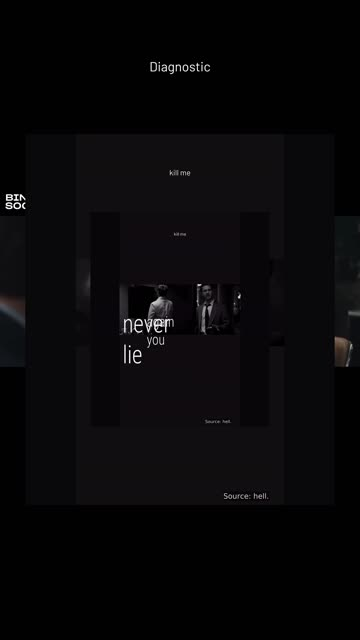
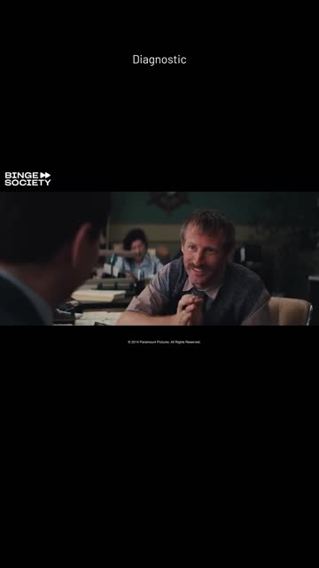

# Video refraction: verified cause and solution map

Reverified on 2026-10-20 against a main-branch snapshot in an isolated
worktree. This is a diagnosis and implementation handoff; no application
rendering behavior or production records were changed.

## Finding

**Completed videos are automatically reused as Library overlays on later videos.** The smaller video already includes captions, top text, credits, and sometimes an earlier overlay, so the result contains several nested generations. The overlay is scheduled at **0.65–3.4 seconds** (shorter for clips under 3.6 seconds), which explains why the problem clears after a few seconds.

A historical Music/Smart job matching the screenshots had multiple clips with generated-Library overlay provenance. The selected generated asset belonged to that same job. This confirms the earlier [detailed diagnosis](video-overlay-diagnosis.md).

### Evidence using the supplied video

Used an authorized diagnostic video source retained in isolated scratch storage. Fresh renders use a bounded source interval.

| Current renderer with matched generated overlay | Same renderer with `overlays=[]` |
| --- | --- |
|  |  |

Both renders keep the same Music theme, top text, timing, and source. At 0.3, 1.5, and 3.6 seconds the average absolute decoded gray-pixel differences are **0.0813, 10.0858, and 0.0945** respectively (0–255 scale; frames downscaled identically to 180×320). The difference is concentrated inside the scheduled overlay interval. Visual inspection shows the same nested captions and rectangles as the supplied screenshots. A fresh square Fast render also validates at 1080×1080, H.264/AAC.

These are **direct FFmpeg renderer experiments**, not full API jobs. The saved affected Music lyric query selects the real generated asset; the supplied new video supplies the underlying footage. This does not establish that this video's natural dialogue would select that asset independently. Earlier evidence includes Speech Smart, Speech Fast, Music, and landscape renders. No new Whisper or provider calls were needed.

## Code path and why it recurs

1. [`_publish_output`](../../engine/jobs.py#L1151) registers successful outputs as `generated-clip`. Keep this intentional Library publication behavior.
2. [`LibraryRules.explain`](../../engine/library.py#L114) iterates all visual assets, without an overlay eligibility or origin gate. A title substring alone contributes 20 points; `required` can reserve placement even without a content hit.
3. [`_process_clip_smart`](../../engine/jobs.py#L2050) resolves again for each clip immediately before rendering ([line 2260](../../engine/jobs.py#L2260)), after earlier clips have published. Planning-time labels do not freeze the eventual rendered selection.
4. [`_source_clip_visual_metadata`](../../engine/jobs.py#L380) schedules the resolved file at 0.65–3.4 seconds.
5. [`_overlay_inputs`](../../engine/media.py#L2185) loops video assets; [`_filters`](../../engine/media.py#L2380) scales/pads them into an opaque centered box, 86% of output width by 58% of height.
6. A selected clip containing its own overlay carries all of those older pixels into the next output. The live candidate pool allows the same job to feed itself, and other jobs' outputs can also seed recursion.

The title-match explanation currently says “reserved eligible placement” when no trigger/tag hits are listed, even for a neutral title match. Fix that diagnostic text independently of the deterministic scoring weights. Changing the language model does not change this local selection/composition path.

## Mode exposure map

Independently reran **72 resolved route combinations**: 32 Smart and 40 Fast, spanning Speech/Music, Short/Long, Standard/High-volume, all four styles, and Auto/Engine only execution. These are route checks, not 72 media renders. Inspected the remaining creation, rerender, and download paths separately.

| Mode or action | Route on inspected main | Exposure to adding this unintended Library layer |
| --- | --- | --- |
| Speech Short: Smart or requested Auto; either batch size | Smart | Yes, if a visual asset matches |
| Speech Short: explicit Fast; either batch size | Fast | No implicit visual lookup |
| Music Short: Fast/Smart/Auto requested | Forced Smart | Yes; production example confirmed |
| Speech Long: Standard, any processing mode | Fast | No implicit visual lookup |
| Speech Long: High-volume Smart/Auto | Smart exception | Yes |
| Speech Long: High-volume Fast | Fast | No implicit visual lookup |
| **Shorts Editor: burned or embedded captions enabled** | Smart via `_queue_shorts_job` | **Yes; include in fix and regression coverage** |
| Shorts Editor: burned and embedded captions both disabled | Fast | No implicit visual lookup |
| Shorts Editor source: Library selection, upload, or YouTube | Same caption-dependent routing | Source choice does not guard Smart composition |
| Funny / Serious / Educational / Hype | No eligibility gate | All share their route's exposure |
| 9:16 / 16:9 / 1:1 / 4:5 where supported | Shared compositor | Aspect changes geometry, not eligibility |
| Auto execution / Engine only; provider disconnected | Same local lookup | Cloud access does not prevent the defect |
| Subtitles off on an otherwise Smart Clip job | Smart | Old video's burned captions remain visible |
| Music color / grayscale, theme, top text, separate song/mixing | Same Smart lookup | Cosmetic/audio options do not prevent it |
| Retry / resume / restart on Smart job | Live resolver again | Candidate choice can change as inventory changes |
| Switch to Fast | New source-based Fast job | No new automatic Library layer; loses Smart-only features |
| Caption revision | Source-based `render_fast_clip`, empty overlays | No new implicit lookup; do not treat as a complete repair workflow |
| Download Video (`video-downloads`) | Download + MP4 remux/transcode | No Library compositing; existing source pixels remain |
| Preview / standalone MP4 / ZIP | Consume already rendered outputs | Existing bad pixels remain in each delivery path |
| Script / AI Video creation | Retired | Historical outputs can still carry baked-in layers |

Music Long and Music High-volume are rejected combinations. Fast and source-only rendering cannot remove an overlay already baked into the imported **source**. Repairs must use the clean saved original, not an affected generated clip selected from the Library.

The Shorts Editor exposure is an addition to the original mode map: [`_queue_shorts_job`](../../engine/app.py#L689) selects Smart when `burn_subtitles` **or** `embed_subtitles` is enabled. Its public upload/URL form and authorized Library-source route both reach that helper.

## Historical deployment compatibility note

A read-only check of a historical local deployment found the engine health check
available while Library reads failed because stored asset data and deployed
model code were incompatible. This is a deployment-version mismatch, distinct
from the original encoded-video problem. The investigation did not establish
which component introduced the unsupported metadata. It made no database or
media changes.

Resolve this by coordinating compatible application and data versions, then
verify health, Library and job reads. Do not delete assets, strip saved fields
from production data, or relax model validation as a workaround.

The renderer experiment used an in-memory projection of read-only asset payloads
to match the inspected baseline model. It did not write to SQLite or repair the
historical deployment. This projection is recorded in the evidence.

## Implementation status and remaining deployment work

The fix is implemented on the integration branch and ready to merge:

- New Clip jobs default to no automatic Library video. Smart job creation persists the explicit choice in both public Job state and the private checkpoint. The UI exposes it only on routes that honor it.
- Automatic B-roll requires an explicit manual-asset eligibility flag. Generated clips and project sources remain in the Library but are ineligible. The Library policy score remains unchanged; matching explanations now call title matches by name instead of saying they were reserved.
- Eligible choices are resolved and persisted for every clip before output publication starts, with the asset/blob identity, query, attribution, and reason. Rendering and caption revisions load only that snapshot, so retries, process recovery, and later Library additions cannot silently change composition.
- The new source-only version action creates a new job from the original source and saved clip ranges, keeps previous output references intact, and carries user-reviewed caption cues to the new clip IDs. Captions, Music treatment/audio, hook/top text, creator credit, and other saved render options remain on the new job.
- The additive database migration defaults old assets to ineligible and preserves any already stored opt-in. Read-only validation confirmed the new models parse existing database records. A database copy upgraded through migration 12 kept assets ineligible by default; the live database was not modified.

| Phase | Status | Remaining gate |
| --- | --- | --- |
| 0. Coordinate deployment | **Pending deployment** | Rebuild/restart a compatible service version; verify health, Library reads, and job reads against isolated acceptance data. |
| 1. Stop implicit overlays | **Implemented** | After deployment, verify every default-off entry point, including Music, High-volume landscape, Shorts Editor, and retries. |
| 2. Make optional B-roll explicit and stable | **Implemented** | Acceptance-check explicitly eligible manual still/video assets and exclusions with a contaminated Library. |
| 3. Repair old outputs safely | **Implemented** | Exercise the queued new-version flow through a real render and publication, including edited caption cues and Music settings. Existing exports remain unchanged until the user creates versions. |
| 4. Verify and integrate | **In progress** | Complete contaminated-Library media acceptance after deployment, run the full repository gate, and verify preview, MP4, and ZIP outputs. |

### Verification so far

- Frontend: **426 passed** across 33 test files; lint, provider check, and typecheck passed. Production build passed.
- Targeted engine checks after the latest caption preservation change: **62 passed** across API, Library rules, eligibility migration, snapshot replay, and source-only version behavior. A further Fast-render check confirmed the clean branch remains green after the caption replay path was added.
- Full engine suite: **759 passed, 114 skipped**. The host's default fontconfig did not see the repository's vendored Montserrat face, so the suite was rerun with a temporary fontconfig file that points at the existing `engine/fonts` files. No font or application test was changed. Skips are existing media/tool gates.
- Fresh render comparisons using the diagnostic video are recorded above. Current deployment compatibility was also verified using read-only copies and the new models; no production jobs or assets were altered.

## Planned deployment, acceptance, and integration

| Phase | Work | Completion gate |
| --- | --- | --- |
| 0. Coordinate current state | Reconcile existing implementation branch and deployment compatibility. Back up persistent data before any deployment/migration. Use isolated test data. | Compatible deployed schemas; Library and job reads work, not only health. |
| 1. Stop implicit overlays | Default new jobs to no personal-Library video composition. Persist the choice in public Job, private snapshot, API, and frontend. Skip **all** resolver calls in off mode, including planning labels. Cover Smart Speech, Music, High-volume landscape, and Shorts Editor. Specify legacy queued/recovered/retry behavior. Preserve captions, emoji, hook/top text, credits, subscriptions, and audio. | A contaminated Library cannot add a video/image layer to any default new source-based job. No silent switch of all jobs to Fast. |
| 2. Make optional B-roll explicit and stable | Require both job opt-in and deliberately approved manual assets. Exclude generated clips, Script outputs, project sources, and current job/project/source identity. Freeze authorized choices before publishing the first output; persist IDs, immutable blob identity, timing, and provenance through retry/restart/caption revisions. Keep scoring weights and normal Library visibility unchanged. | Publishing clip 1 cannot change the composition of clips 2 onward. Other projects' generated outputs cannot be selected implicitly either. |
| 3. Repair old outputs safely | Add an explicit source-only new-job/version action using original source, exact saved trim, edited captions/timing, treatment, text, audio settings, and lineage. Preserve old outputs. Publish new validated files through existing transactional clip/asset APIs. Recompute actual-layer provenance. | Original bytes and old references remain intact. New outputs contain the authorized composition and remain downloadable/exportable. |
| 4. Verify and integrate | Exercise every exposed route against a contaminated isolated Library, plus deliberate manual B-roll opt-in. Test inter-clip publication, cross-job recursion, legacy/retry/restart, unavailable blobs, caption revisions, and regeneration failure/retry. Decode frames before/during/after the interval; check A/V sync, text/effects, dimensions, MP4, preview, and ZIP. Run repository gates, integrate latest main, then deploy compatible services. | Real decoded pixels contain no unrequested old content; actual Library/job endpoints and playback work after deploy. Existing bad outputs are only claimed repaired after regeneration. |

## Verification and retained artifacts

Focused tests run from this isolated branch: **113 passed, 10 skipped** across `test_library.py`, `test_fast_mode.py`, `test_long_form.py`, `test_high_volume_batches.py`, `test_shorts_source.py`, and `test_video_downloads.py`. Skips are existing media-tool gates on the host; fresh FFmpeg experiments ran inside the existing engine container with outputs only in `/tmp`. Passing baseline tests does not establish the missing exclusion rule.

Fresh machine-readable evidence: [video-refraction-reverification.json](video-refraction-reverification.json). Fresh sample frames are linked above. The read-only driver, three MP4s, all before/during/after frames, evidence, and focused test log are retained in private ignored investigation artifacts. The initial source download remains in private scratch storage. No production job was queued or published by this investigation.

Browser playback acceptance was not performed: T3 preview startup reported missing host libraries (`libnspr4.so`, `libnss3.so`, `libnssutil3.so`, `libasound.so.2`). Decoded-media checks establish the rendering defect independently of browser playback.
